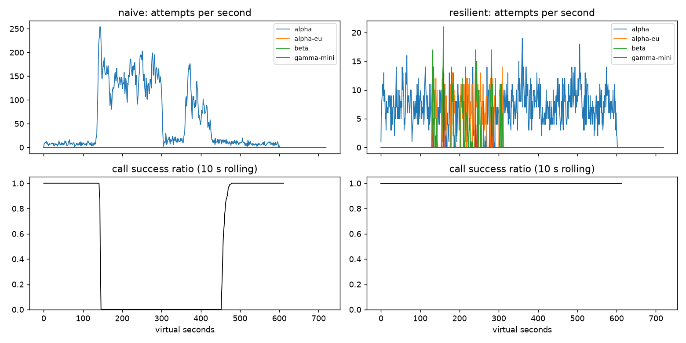

# Lab 25B — Report

**Họ tên / nhóm:** Nguyen Cong Duan / chưa có thông tin nhóm  
**Commit report/scoreboard:** `6fe9da044540108a4f38ba3aab007c186703aaa0` (commit chứa report và scoreboard; metadata được ghi nhận ở commit kế tiếp)
**Điểm tự động (`make grade`):** 84/88 trên grader công khai, seeds 25–27; 4 điểm SLO ẩn do giảng viên chấm. Phần report/postmortem chấm tay: tối đa 12 điểm.

Các số liệu Game Day lấy từ `reports/gameday/naive.json` và `reports/gameday/resilient.json` (seed 25); workflow và SLO lấy từ `reports/workflows.json` và `reports/slo.json`. Các thí nghiệm tùy biến chạy lại cùng simulator, cùng seed và chỉ thay đổi cấu hình được nêu ở từng mục.

## 1. Kết quả Game Day (naive vs của bạn)

| Băng | Client | availability | p95 (s) | amplification | retry_ratio | cost/turn | recovery (s) | PASS? |
|---|---|---:|---:|---:|---:|---:|---:|:---:|
| G1 rate limit | naive | 0.7194 | 7.157 | 7.738 | 6.738 | 2.163 | 4 | FAIL |
| G1 rate limit | yours | 1.0000 | 4.781 | 1.061 | 0.002 | 2.097 | 0 | PASS |
| G2 overload | naive | 0.4560 | 15.034 | 9.904 | 8.904 | 4.627 | 155 | FAIL |
| G2 overload | yours | 1.0000 | 10.800 | 1.081 | 0.011 | 2.209 | 0 | PASS |
| G3 brownout | naive | 1.0000 | 4.768 | 1.164 | 0.164 | 2.328 | 0 | FAIL |
| G3 brownout | yours | 1.0000 | 4.745 | 1.030 | 0.012 | 2.092 | 0 | PASS |
| G4 slow region | naive | 1.0000 | 13.764 | 1.004 | 0.004 | 2.008 | 0 | FAIL |
| G4 slow region | yours | 1.0000 | 5.532 | 1.030 | 0.003 | 2.099 | 0 | PASS |
| G5 bad deploy/quota | naive | 0.3699 | 5.359 | 17.030 | 16.030 | 2.124 | n/a | FAIL |
| G5 bad deploy/quota | yours | 0.8179 | 5.472 | 1.004 | 0.003 | 2.504 | n/a | PASS |
| G6 provider outage | naive | 0.5170 | 4.836 | 12.344 | 11.344 | 2.009 | 0 | FAIL |
| G6 provider outage | yours | 1.0000 | 6.054 | 1.050 | 0.016 | 2.215 | 0 | PASS |

`cost/turn` là chi phí trên lượt thành công (`cost_per_good_turn`). `recovery` không áp dụng cho G5 vì tape không có thời điểm khôi phục có thể đo. Resilient client PASS cả 6 tape ở seed công khai này; các kết quả nhiều seed/seed ẩn vẫn cần được xác nhận ở grader.

## 2. Cấu hình client và lý do

| Tham số | Giá trị | Vì sao (dựa trên băng nào, số liệu nào) |
|---|---:|---|
| `attempt_timeout_s` | 6.0 s | G6 có provider beta bị giới hạn nhưng client vẫn đạt availability 1.0, p95 6.054 s; timeout ngắn hơn deadline lượt 30 s để còn cơ hội failover. |
| `max_attempts_per_provider` | 2 | Tối đa một retry cùng provider rồi failover; G2 amplification 1.081 so với naive 9.904. |
| `backoff_base_s / cap_s` | 0.25 / 4.0 s | Full jitter làm lệch nhịp retry; G1 có 0 retry-after violation và amplification 1.061 (naive: 36,027 violation; amplification 7.738). |
| `retry_budget_ratio` | 0.1 | Giới hạn retry ở mức khoảng 10% số request ban đầu; quan sát G2 retry_ratio 0.011, G3 0.012 và G6 0.016. |
| `breaker.window_size / min_calls` | 10 / 5 | Nhìn 10 kết quả gần nhất, chờ tối thiểu 5 call để tránh phản ứng với mẫu quá nhỏ; G2 đạt recovery 0 s theo tape thay vì 155 s ở naive. |
| `breaker.failure_rate_threshold` | 0.5 | Mở breaker khi đa số call trong cửa sổ gần đây lỗi; dùng để giảm tải provider có vấn đề, không xem quota/ lỗi phía client là sức khỏe provider. |
| `breaker.slow_call_s / slow_rate_threshold` | 5.0 s / 0.6 | Nhận diện provider chậm khi ít nhất 60% cửa sổ vượt 5 s; G4 resilient p95 5.532 s so với naive 13.764 s. |
| `breaker.open_duration_s` | 10.0 s | Tạm ngừng gửi vào provider đang lỗi, sau đó thử phục hồi thay vì tiếp tục khuếch đại lỗi; G2 resilient recovery 0 s. |
| `breaker.half_open_max_probes / half_open_successes` | 2 / 2 | Giới hạn thăm dò đồng thời và yêu cầu hai lần thành công trước khi đóng breaker; tránh dồn tải lớn ngay khi provider vừa hồi phục. |

Quyết định khi có lỗi:

| Loại lỗi | Ghi breaker? | Retry cùng provider? | Failover? | Hành động bổ sung |
|---|---|---|---|---|
| Rate limit (429, có thể kèm `Retry-After`) | Không | Có, tuân thủ `Retry-After` và budget | Có | Đặt cooldown theo provider |
| Overloaded (503/529), server error (5xx), timeout | Có | Có nếu còn attempts, budget và deadline | Có | Breaker theo dõi lỗi/chậm |
| Quota exhausted | Không | Không | Có thể thử provider khác | Cooldown dài và cần cảnh báo quota |
| Client error (4xx) | Không | Không | Không | Dừng để tránh gửi lại request không hợp lệ |

## 3. Ba thí nghiệm

Các kết quả dưới đây là một lần chạy deterministic với seed 25. Với thí nghiệm retry budget, cấu hình breaker cố ý sai (`min_calls: 1000000000`) và `max_attempts_per_provider: 5`; so sánh budget ratio 0.1 với budget bị nới đến mức thực tế không giới hạn.

1. **Retry budget là lớp phòng thủ cuối.** Ở G2, bật budget cho availability 1.000, amplification 1.402, retry_ratio 0.061 và recovery 0 s; tắt budget làm availability còn 0.9458, amplification tăng lên 1.781, retry_ratio lên 0.515 và recovery thành 66 s. Ở G3, availability vẫn 1.000 ở cả hai lượt, nhưng khi tắt budget amplification tăng 1.136 → 1.164 và retry_ratio 0.068 → 0.163. Budget vẫn cần bên cạnh breaker: breaker ngăn gửi vào một provider đã được xác định là lỗi, còn budget giới hạn tổng retry khi breaker sai cấu hình, chưa đủ mẫu hoặc tải được chuyển sang provider khác.

2. **`attempt_timeout_s: 30`.** Trên G6, timeout mặc định 6 s đạt availability 1.000, p95 6.054 s và không có give-up; tăng lên 30 s làm availability giảm còn 0.9543, có 102 deadline give-up và 7 `no_provider_available` (p95 các lượt thành công là 5.387 s). P95 thấp hơn không có nghĩa trải nghiệm tốt hơn: các lượt treo lâu rồi hết deadline bị loại khỏi tập lượt thành công (survivorship bias). G4 gần như không đổi: availability vẫn 1.000, p95 từ 5.532 xuống 5.445 s và amplification từ 1.030 xuống 1.014, vì alpha vẫn trả lời chậm thêm 5 s chứ không treo như alpha-eu ở G6. Timeout nên được đặt từ p99 bình thường, deadline người dùng và ngân sách thời gian cần cho failover; không nên chọn chỉ để làm p95 đẹp.

3. **Bỏ lọc tool calling khỏi `ladder()`.** Trên G6, đưa cả provider không hỗ trợ tool vào ladder tạo 259 `incompatible_routes`; availability giảm từ 1.000 xuống 0.8914, với 4,715 attempts và cost 2.271 mỗi lượt thành công. Nói theo góc nhìn sản phẩm: trong tape có 259 lần hệ thống gửi yêu cầu cần gọi công cụ tới một mô hình không có chức năng đó, nên lượt trả lời không đáp ứng được yêu cầu dù API có thể trả response. Lọc theo capability trước khi gửi tránh lỗi loại này thay vì để người dùng nhận câu trả lời sai chức năng.

## 4. Workflow hoàn tiền

| Executor | completion | crashes | duplicate refunds | duplicate emails | lost refunds | overpaid | wasted LLM / crash |
|---|---:|---:|---:|---:|---:|---:|---:|
| naive | 500/500 (100%) | 81 | 128 | 81 | 0 | 1,496,700 cents | 1.123 |
| yours | 500/500 (100%) | 66 | 0 | 0 | 0 | 0 cents | 0.303 |

Idempotency key ngăn side effect trùng nhưng không lưu tiến độ; nếu worker crash sau khi hoàn tiền, lần resume vẫn phải biết các bước nào đã hoàn tất để không lặp side effect hay LLM work. Checkpoint đơn thuần cũng không ngăn hai worker cùng chạy một bước hoặc service thực hiện side effect lặp lại khi retry; cần idempotency ở biên side effect kết hợp checkpoint bền vững. Nếu ghi checkpoint **trước** khi gọi payment, crash ở giữa sẽ khiến lần resume bỏ qua payment và có thể làm mất refund.

## 5. Alerting & error budget

| Sự cố | Mong đợi | Naive alerter | Burn-rate alerter | Độ trễ phát hiện (burn-rate) |
|---|---|---|---|---:|
| checkout_bug | page | Page, 1 phút | Page | 27 phút |
| provider_outage | page | Page, 0 phút | Page | 4 phút |
| deploy_blip | none | Page nhầm | Không alert | — |
| slow_leak | ticket | Không phát hiện | Ticket | 1,337 phút |
| degraded_evening | page | Page, 214 phút | Page | 291 phút |
| night_spike | none | Page nhầm | Không alert | — |
| small_bump | none | Page nhầm | Không alert | — |

Naive tạo 7 page, trong đó 3 false page và không phát hiện slow leak; burn-rate tạo 3 page, 1 ticket và 0 false page. Trên 25,901,755 request, có 55,618 bad request; error budget cho SLO 99.5% là 129,508.8 request. Đã tiêu 42.95%, còn 57.05%, `freeze_releases = false`.

`small_bump` kéo dài 20 phút với 12% lỗi không nên đánh thức on-call vào giờ trưa chỉ dựa vào tỷ lệ lỗi ngắn hạn: quy tắc page yêu cầu đồng thời long window 1 giờ và short window 5 phút đạt burn 14.4x, còn short spike này chưa đủ ảnh hưởng dài hạn để đạt cả hai ngưỡng. Cách này phân biệt sự cố có thể làm cạn error budget với biến động ngắn không cần page.

## 6. Postmortem — Băng G2 với client naive (blameless)

CSV nguồn: `reports/gameday/naive_G2_overload_storm_timeseries.csv`. Attempts/s là tổng attempts của các provider ở giây đó; success ratio là `calls_ok / calls_done` trên cửa sổ rolling 10 giây, như cách tính trong plot.

**Tóm tắt (3 câu):** Ở t=120, alpha mất 75% GPU trong 180 giây; naive client tiếp tục gửi và retry đến khi attempts đạt 163/s ở t=150, trong khi success ratio rolling giảm về 0. Alpha được khôi phục ở t=300, nhưng client vẫn có 9.904 attempts cho mỗi logical call, availability cả tape chỉ 45.6% và hệ thống mất thêm 155 giây mới hồi phục. Sự cố cho thấy retry không được giới hạn và điều phối tập trung có thể biến gián đoạn năng lực thành overload kéo dài; đây là khoảng trống của cơ chế hệ thống, không phải lỗi của một cá nhân.

**Ảnh hưởng:** 1,077/2,362 lượt thành công, tức 1,285 lượt thất bại (54.4%) trong tape; p95 lượt thành công là 15.034 s. Từ lúc bắt đầu ảnh hưởng ở t=120 đến lúc alpha phục hồi hoàn toàn ở t=300 là 180 s; client naive hồi phục ở khoảng t=455 (thêm 155 s). Ước tính với 4 lượt/s liên tục trong 30 ngày, error budget 0.5% tương đương 51,840 lượt; 1,285 lỗi của tape tiêu thụ khoảng **2.48%** ngân sách tháng nếu sự cố này là nguồn lỗi duy nhất.

**Timeline** (giây ảo — số liệu từ CSV):

| t | Sự kiện | Bằng chứng (số) |
|---:|---|---|
| 0 | Đầu tape, provider bình thường | 1 attempt/s; success ratio 1.00 (cửa sổ đang khởi tạo) |
| 119 | Ngay trước sự cố | 9 attempts/s; success ratio 1.00 |
| 120 | Alpha mất 75% GPU, capacity factor còn 0.25 | 5 attempts/s trong giây đầu; success ratio rolling vẫn 1.00 do cửa sổ còn call thành công trước đó |
| 150 | Retry/queue bắt đầu khuếch đại tải | 163 attempts/s; success ratio rolling 0.00 |
| 180 | Overload tiếp diễn | 138 attempts/s; success ratio rolling 0.00 |
| 240 | Tải retry vẫn cao | 105 attempts/s; success ratio rolling 0.00 |
| 299 | Còn một giây trước khi alpha phục hồi | 136 attempts/s; success ratio rolling 0.00 |
| 300 | Alpha phục hồi hoàn toàn | 115 attempts/s; success ratio rolling 0.00 |
| 330 | Tải giảm tạm thời nhưng chưa có call thành công trong cửa sổ | 6 attempts/s; success ratio rolling 0.00 |
| 372 | Retry/queue spike sau khi provider đã hồi phục | 176 attempts/s (đỉnh sau t=300); success ratio rolling vẫn 0.00 |
| 420 | Vẫn xử lý tồn đọng/retry | 53 attempts/s; success ratio rolling 0.00 |
| 455 | Bắt đầu có dấu hiệu hồi phục | 13 attempts/s; success ratio rolling 0.30 |
| 480 | Hệ thống ổn định lại | 8 attempts/s; success ratio rolling 1.00 |

**Trigger vs root cause:** Trigger là alpha mất 75% năng lực GPU trong khoảng t=120–300. Root cause là retry ở nhiều lớp không có jitter, retry budget hoặc breaker hiệu quả; amplification đạt 9.904 (34,475 attempts / 3,481 calls) và làm lượng việc đến alpha vượt quá năng lực còn lại. Khi alpha khôi phục ở t=300, request cũ vẫn nằm trong queue hoặc đã hết deadline ở phía caller nhưng còn tiêu tốn capacity; retry mới tiếp tục cạnh tranh với request mới, tạo vòng lặp metastable: queue dài → timeout/overload → retry → thêm tải và queue dài. CSV thể hiện điều đó qua 115 attempts/s và success ratio 0 ở t=300, cùng spike 176 attempts/s ở t=372.

**Điều gì giúp / điều gì làm tệ hơn:** Deadline người dùng giới hạn thời gian chờ của từng lượt nhưng không hủy ngay mọi công việc đã xếp hàng ở provider; do đó đây không phải biện pháp đủ để giảm tải. Mọi request tiếp tục tập trung vào alpha, retry không được giãn nhịp hay giới hạn theo tổng lưu lượng, và queue có thể xử lý công việc vô ích sau khi caller đã từ bỏ. Trong cùng tape, resilient client có availability 1.000, amplification 1.081, recovery 0 s, retry-after violations 0 và p95 10.800 s; điều đó chứng minh failover, breaker và retry budget hạn chế được khuếch đại, dù độ trễ G2 vẫn là điểm yếu.

**Action items**:

| # | Hành động | Loại (prevent / detect / mitigate) | Owner | Cách kiểm chứng |
|---|---|---|---|---|
| 1 | Đưa giới hạn retry toàn cục, full jitter và circuit breaker vào thư viện client dùng chung; giữ capability-aware failover. | prevent | Nhóm nền tảng AI | CI chạy G2/G6 trên ít nhất 3 seed: amplification ≤ 1.6, availability ≥ 0.95, retry-after violations = 0. |
| 2 | Dashboard/cảnh báo theo provider cho attempts/logical call, queue wait, timeout và success ratio 10 giây; không chỉ nhìn availability tổng. | detect | SRE / on-call | Replay CSV G2: cảnh báo khi amplification > 1.5 hoặc success ratio < 0.9 trong 2 cửa sổ; có tín hiệu trước khi t=150. |
| 3 | Khi breaker mở, chuyển lưu lượng sang provider tương thích và giới hạn concurrency/queue; hủy công việc còn có thể hủy sau deadline. | mitigate | Nhóm tích hợp model | G2/G6: recovery ≤ 30 s sau restore, availability ≥ 0.95, không route tool tới provider không hỗ trợ. |

## 7. Một điểm yếu còn lại

Resilient client giữ availability 1.000 ở G2 nhưng p95 vẫn 10.800 s và p99 15.606 s; vì vậy khả năng hoàn tất request chưa đảm bảo độ trễ thân thiện với người dùng. Một cải tiến tiếp theo là dùng tín hiệu queue/latency gần thời gian thực để failover sớm hơn thay vì đợi lỗi/timeout, đồng thời giới hạn số request đồng thời trên từng provider. Tiêu chí xác nhận: trên G2 với ít nhất 3 seed, giữ availability ≥ 0.95 và amplification ≤ 1.6, đồng thời giảm p95 xuống ≤ 8 s mà không làm tăng lỗi ở G4.

## 8. Cache (Part G)

Số liệu từ `reports/cache/resilient.json` và `reports/cache/cached.json`:

| Client | availability | faq_availability | cache_hit_ratio | stale_served | wrong_answers | outdated_answers | cost/turn | PASS? |
|---|---:|---:|---:|---:|---:|---:|---:|:---:|
| resilient (không cache) | 0.8380 | 0.8430 | 0.000 | 0 | 0 | 0 | 1.386 | FAIL |
| cached (của bạn) | 0.9124 | 0.9640 | 0.652 | 156 | 0 | 3 | 0.916 | PASS |

| Tham số `cache:` | Giá trị | Vì sao (số liệu nào) |
|---|---:|---|
| `similarity_threshold` | 0.95 | Cache trả lời FAQ với hit ratio 0.652 và 0 wrong answer. Thử 0.80 tạo 166 wrong answer thuộc `other_question`; 0.97 không sai nhưng hit ratio giảm còn 0.578. |
| `ttl_s` | 60 | 60 s giới hạn thời gian giữ câu trả lời có thể lỗi thời do silent update; C1 ghi nhận 3 outdated answer, đạt ngưỡng tối đa 15. 300 s làm outdated tăng lên 95. |
| `max_stale_s` | 180 | Tạo khoảng đệm khi provider outage 120 s: C1 phục vụ stale 156 lượt và FAQ availability đạt 0.964. Nếu đặt 0, FAQ availability còn 0.8733, giảm 9.07 điểm phần trăm. |
| `max_entries` | 500 | Giới hạn bộ nhớ/cache growth; C1 đạt hit ratio 0.652 trong giới hạn này, không có bằng chứng từ tape cho thấy cần tăng capacity. |

**Thí nghiệm (cùng C1, seed 25):**

1. **Ngưỡng.** Ở 0.80, hit ratio 0.659 nhưng 166 câu trả lời sai đều phân loại `other_question`, FAQ availability 0.8651 và cost/turn 0.975. Ở 0.95, hit ratio 0.652, 0 wrong answer, FAQ availability 0.964 và cost/turn 0.916. Ở 0.97, wrong answer vẫn 0 nhưng hit ratio giảm còn 0.578, FAQ availability 0.9628 và cost/turn 0.966; 0.95 là điểm cân bằng tốt hơn trong tape này.
2. **TTL.** TTL 30/60/300 s lần lượt cho hit ratio 0.588/0.652/0.731 và outdated answers 2/3/95; 300 s tăng hit nhưng vượt xa ngưỡng outdated tối đa 15. Webhook chỉ thông báo các thay đổi được phát ra, không biết về silent update của shipping policy tại t=480; do đó TTL là giới hạn cuối cùng cho độ cũ của entry không được invalidation.
3. **Stale-if-error.** Với `max_stale_s: 0`, FAQ availability giảm từ 0.9640 xuống 0.8733 và stale_served từ 156 xuống 0; cache vẫn có hit nhưng không thể dùng entry đã quá TTL để che phủ outage. Bản C1 chuẩn giữ `outdated_answers` ở 3.

**Trả lời:**

- Câu hỏi cá nhân như “Đơn #48213 của tôi đang ở đâu?” không nên đưa vào semantic cache: nội dung nhạy cảm và thay đổi theo trạng thái đơn hàng; kể cả phân vùng theo user vẫn có nguy cơ rò rỉ qua lỗi phân quyền, key không đầy đủ hoặc dùng lại sai ngữ cảnh, đồng thời khó bảo đảm invalidation đúng thời điểm. Câu hỏi này cần truy vấn nguồn dữ liệu có kiểm soát quyền thay vì lưu câu trả lời dùng lại.
- Khi cache đang che lỗi provider, cần cảnh báo độc lập theo trạng thái nguồn gốc: availability/error rate và burn rate của provider, số lượng/tỷ lệ `stale_served`, tuổi dữ liệu được phục vụ và cache-hit ratio. Dashboard chỉ báo FAQ availability sẽ có thể xanh giả; cảnh báo upstream phải kích hoạt ngay cả khi cache giữ được trải nghiệm người dùng.
